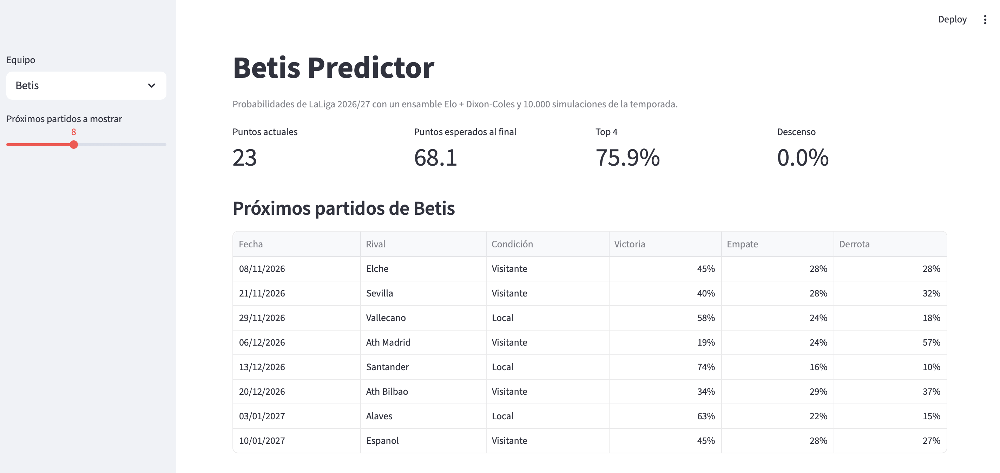
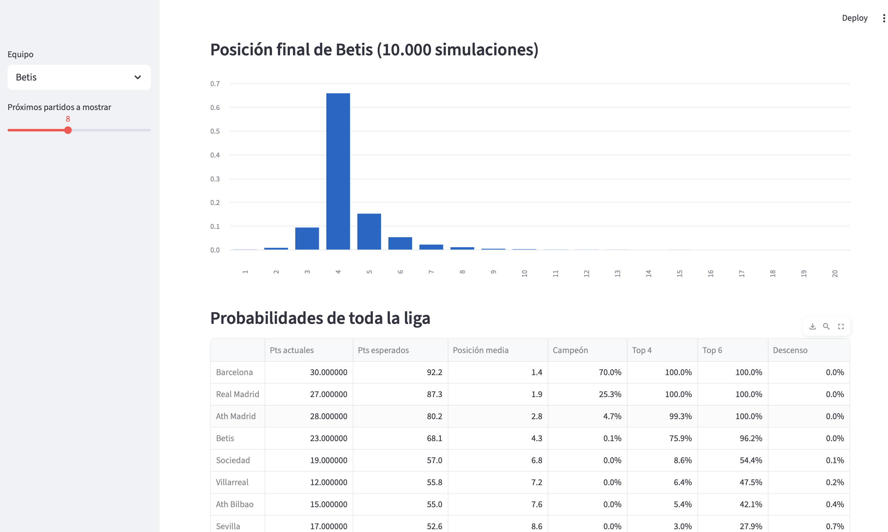

# Betis Predictor

Predicción de resultados de LaLiga (victoria / empate / derrota) con un modelo
propio, comparado con las cuotas del mercado, y simulación de la temporada
2026/27 con foco en el Real Betis.




## Resultado principal

Evaluación en un test temporal que el modelo no vio (temporadas 2023/24 a
2025/26, 1.140 partidos). Menor es mejor.

| Modelo | Log-loss | Brier | RPS |
|---|---|---|---|
| Línea base (frecuencias de train) | 1,0650 | 0,6432 | 0,2253 |
| Elo + regresión logística | 0,9732 | 0,5774 | 0,1945 |
| Dixon-Coles | 0,9722 | 0,5773 | 0,1946 |
| **Ensamble 50/50** | **0,9696** | **0,5754** | **0,1937** |
| Mercado (media de cuotas de cierre) | 0,9537 | 0,5653 | 0,1886 |

- El modelo mejora claramente la línea base y queda a ≈ 0,016 de log-loss del
  mercado. Esa diferencia con el mercado es pequeña, pero distinguible
  (IC 95 % bootstrap por bloques: [+0,0065, +0,0254]).
- Entre Elo, Dixon-Coles y el ensamble **no hay diferencias distinguibles**
  (los intervalos incluyen 0).
- El mercado conoce alineaciones, lesiones y noticias, que no están en los datos.

## Datos

- Resultados, estadísticas y cuotas de LaLiga 2016/17 a 2026/27 (3.909
  partidos) de [football-data.co.uk](https://www.football-data.co.uk/).
- Calendario 2026/27 de [fixturedownload.com](https://fixturedownload.com/).
- Benchmark: media de las cuotas de cierre del mercado (`AvgC*`), disponible
  desde 2019/20, con el margen de la casa eliminado por normalización.

## Metodología

1. **EDA:** ventaja de jugar en casa (45,5 % / 26,2 % / 28,3 %), contrastes de
   bondad de ajuste de Poisson para los goles (ligera sobredispersión,
   índice ≈ 1,07) y calibración del mercado.
2. **Elo** con regresión logística sobre la diferencia de rating. Los
   equipos que no jugaron la temporada anterior reinician a 1500.
3. **Dixon-Coles:** ataque y defensa por equipo, corrección de marcadores bajos,
   pesos temporales (ξ = 0,001, elegido en validación) y reajuste mensual
   con solo partidos anteriores (*walk-forward*).
4. **Ensamble:** promedio 50/50, sin parámetros ajustados con el test.
5. **Validación temporal sin fuga de datos:** train 2016/17-2022/23, test
   2023/24-2025/26. Los hiperparámetros se eligen en 2021/22-2022/23, y el
   test se evalúa una sola vez.
6. **Incertidumbre:** bootstrap pareado, simple y por bloques semanales.

## Lo que no funcionó

- Añadir forma reciente, tiros y descanso al Elo **no mejora** el log-loss
  (diferencias de milésimas, dentro del ruido).
- Ajustar los parámetros del Elo mejora el test en 0,0014, muy por debajo del
  ruido.

## Simulación de la temporada 2026/27

10.000 simulaciones de los 271 partidos pendientes con las probabilidades del
ensamble (fuerzas fijas a fecha 2/11/2026).

Betis (23 puntos tras 11 jornadas): posición más probable 4.º (66 %),
75,9 % de top 4, 96,2 % de top 6.

**Backtest:** repitiendo la simulación tras 11 jornadas en 2021/22-2025/26
(100 equipos-temporada), los puntos finales reales caen dentro del intervalo
10-90 % de la simulación en el 82 % de los casos (esperado: 80 %), y la
desviación típica de los residuos tipificados es 1,01. Añadir ruido a la
fuerza de los equipos empeora el Brier, así que no se aplica.

## Limitaciones

- Muestra pequeña en el backtest, con hiperparámetros elegidos en parte sobre
  esas mismas temporadas: resultado algo optimista.
- Las fuerzas no evolucionan durante la temporada simulada.
- Desempate aleatorio en lugar del reglamento (enfrentamiento directo).
- Plazas europeas aproximadas (top 4 / top 6).
- Los equipos que vuelven tras años fuera parten como un equipo medio, algo
  optimista para ellos; no está calibrado con datos.
- Sin lesiones, alineaciones ni fichajes.
- Las cuotas de football-data se recogen en momentos concretos de la semana,
  no exactamente al cierre.

## Cómo reproducirlo

```bash
python -m venv .venv && source .venv/bin/activate
pip install -r requirements.txt
python src/download_data.py   # descarga los CSV a data/raw
python src/clean_data.py      # genera data/processed/laliga_matches.csv
# calendario: descargar a mano de fixturedownload.com -> data/raw/fixtures_2627.csv
# y generar pending_2627.csv con notebooks/06_fixtures.ipynb
python src/predict.py
python src/simulate.py
streamlit run app.py
```

Notebooks: `01_eda`, `02_baseline`, `03_features`, `04_elo_tuning`,
`05_dixon_coles`, `06_fixtures`.